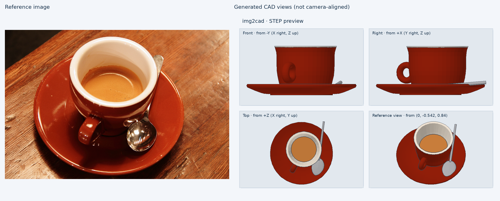

<div align="center">

# img2cad

**Turn a photo, sketch or engineering drawing into editable, coloured CAD — with your coding agent.**

[](https://pypi.org/project/img2cad/)
[](https://pypi.org/project/img2cad/)
[](https://github.com/YUI-TIEN/img2cad/actions/workflows/test.yml)
[](LICENSE)

[Website & 3D examples](https://yui-tien.github.io/img2cad/) · [Install](#install) · [Commands](#commands) · [Examples](examples/) · [How it works](docs/DESIGN.md)



</div>

img2cad gives Claude Code, Codex, Cursor, Gemini CLI or any MCP host a **staged, checked workflow** for image → CAD. The agent reads the image, records what it sees and plans the parts, writes [build123d](https://github.com/gumyr/build123d) source, and the local runner builds it, measures it, and overlays it on the image — refusing to move on until geometry, dimensions and a visual review pass.

You get a parametric `model.py` you can keep editing, plus **STEP** (named, coloured parts), **GLB**, **STL** and **3MF**.

## Highlights

- 🧭 **Agent workflow, not a one-shot guess** — observe → plan → build → compare → revise, with hash-bound gates and resumable revisions.
- 📐 **Real dimensions** — fit the photo's camera to known features (`img2cad camera`), register the model on the image, trace outlines in millimetres.
- 📷 **Any input** — product photos, several photos from any angle (visual hull from fitted cameras), hand sketches, dimensioned drawings.
- ✂️ **Masks in one click** — colour seeds, polygons, or optional [SAM 2](https://github.com/facebookresearch/sam2) segmentation.
- 🎛️ **Live parameter panel** — `img2cad view model.py` opens a 3D viewer with sliders; changes rebuild locally and save back to the source.
- 🏭 **Ready to make** — 3D-print check, slicer hand-off, CNC / sheet-metal DFM, engineering drawings (SVG/DXF), standard parts library, URDF for robots.

## Install

### In your agent

| Host | Install |
|---|---|
| **Claude Code** | `/plugin marketplace add YUI-TIEN/img2cad` then `/plugin install img2cad@img2cad` |
| **Gemini CLI** | `gemini extensions install https://github.com/YUI-TIEN/img2cad` |
| **Codex / Cursor** | add this repository as a plugin (`.codex-plugin/`, `.cursor-plugin/`) |
| **Any agent with skills** | `npx skills add YUI-TIEN/img2cad` |
| **Any MCP host** | command `uvx img2cad mcp` (see below) |

<details>
<summary>MCP server config (Claude Desktop, Cursor, VS Code, …)</summary>

```json
{
  "mcpServers": {
    "img2cad": { "command": "uvx", "args": ["--python", "3.13", "img2cad", "mcp"] }
  }
}
```

</details>

### Command line

```sh
pip install img2cad              # or: uv tool install img2cad
img2cad doctor                   # checks the CAD stack (build123d / OCP)

uvx img2cad doctor               # run without installing
pip install "img2cad[sam]"       # optional: SAM 2 segmentation for `img2cad mask --sam`
```

Python 3.10–3.13. Latest from GitHub: `pip install git+https://github.com/YUI-TIEN/img2cad`.

<details>
<summary>From a clone (contributors)</summary>

```sh
git clone https://github.com/YUI-TIEN/img2cad && cd img2cad
python3 -m venv .venv-cad && .venv-cad/bin/pip install -r requirements-cad.lock -e .
.venv-cad/bin/img2cad doctor
```

</details>

## Quick start

Give your agent an image and ask:

> Turn `mug.jpg` into editable CAD. It is 95 mm tall. Use img2cad.

The agent follows [`skills/img2cad/SKILL.md`](skills/img2cad/SKILL.md): it runs `img2cad workflow init`, records observations and a part plan, writes `model.py`, builds it, compares it with the photo, and revises until the review passes. Open the result:

```sh
img2cad view runs/mug/model.py      # 3D viewer + parameter sliders
```

## Commands

| Command | What it does |
|---|---|
| `workflow` | staged, resumable image → CAD workflow (`init`, `observations`, `plan`, `run`, `review`, `new-revision`, `promote`, `status`) |
| `build model.py out/` | STEP + GLB/STL/3MF, checks, previews, comparison and registered overlay |
| `camera camera.json` | fit the photo's camera to known circles/points; refuses poor fits |
| `mask photo.png mask.png` | subject mask from polygons, ellipses, colour seeds or `--sam` |
| `hull views.json` | blockout from 2+ silhouettes — front/right/top or photos at any angle |
| `trace image.png` | colour regions → pixel outlines |
| `inspect model.step` | validity, parts, colours, bounds, volume, holes |
| `view` · `params` | 3D viewer with live parameters · list/set parameters |
| `export model.step out/` | GLB (coloured), 3MF (coloured parts), STL |
| `drawing model.step out/` | three-view SVG/DXF with dimensions and a hole table |
| `printcheck model.step` | watertight, overhangs, bed contact, thin walls, build volume |
| `slice model.3mf --out x.gcode` | G-code via installed PrusaSlicer / SuperSlicer / OrcaSlicer / Bambu Studio |
| `dfm model.step --process cnc\|sheet` | CNC: sharp internal corners, tool radii, deep holes, undercuts · sheet: thickness, holes, bends |
| `parts make screw --size M3 --length 12` | ISO screws, nuts, washers, bearings, NEMA 17, 2020 extrusion |
| `urdf model.step --out robot/` | URDF + meshes with joints and exact mass/inertia |
| `mcp` · `doctor` · `version` | MCP server (stdio) · environment check · version |

`img2cad <command> --help` shows every option. Full CLI reference: [docs/WORKFLOW.md](docs/WORKFLOW.md).

## Examples

| | Input | Technique |
|---|---|---|
| [espresso-cup](examples/espresso-cup/) | real photo | camera fitted to three circles, profile from silhouette edges |
| [falcon9-pad](examples/falcon9-pad/) | real photo (NASA) | known dimensions as scale, lattice towers |
| [mounting-plate](examples/mounting-plate/) | dimensioned drawing | fillets, hole patterns, dimension gates |
| [flanged-bushing](examples/flanged-bushing/) | drawing | half-profile revolve |
| [vase](examples/vase/) · [fish](examples/fish/) · [standing-horse](examples/standing-horse/) · [pagoda](examples/pagoda/) | sketches | splines, lofts, limbs, roofs, projected paint |

Each one keeps the whole chain — reference, observations, plan, `model.py`, comparison and review. Browse them in 3D on the [website](https://yui-tien.github.io/img2cad/).

## How it compares

Text-to-CAD tools start from words; mesh generators give you triangles. img2cad starts from **your image** and ends at **editable B-rep source** with measured checks — a workflow your agent runs, not a hosted model. See [docs/DESIGN.md](docs/DESIGN.md) for the design and related projects.

## Documentation

- [docs/DESIGN.md](docs/DESIGN.md) — problem, design principles, acceptance criteria
- [docs/WORKFLOW.md](docs/WORKFLOW.md) — workflow CLI reference and learning material
- [skills/img2cad/SKILL.md](skills/img2cad/SKILL.md) — the agent contract · [MODELING.md](skills/img2cad/MODELING.md) · [LESSONS.md](skills/img2cad/LESSONS.md)
- [skills/cad-output/SKILL.md](skills/cad-output/SKILL.md) — drawings, printing, DFM, parts, URDF
- [benchmark/](benchmark/README.md) · [CHANGELOG](CHANGELOG.md) · [ROADMAP](ROADMAP.md) · [CONTRIBUTING](CONTRIBUTING.md) · [SECURITY](SECURITY.md)

> **Status:** beta. Reviews are agent reviews (`human_acceptance: not_verified`); check the measured geometry and previews before you manufacture anything.

## License

[MIT](LICENSE)
